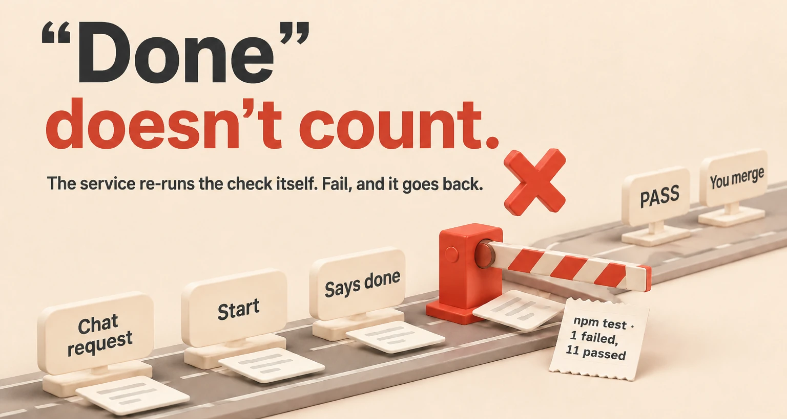
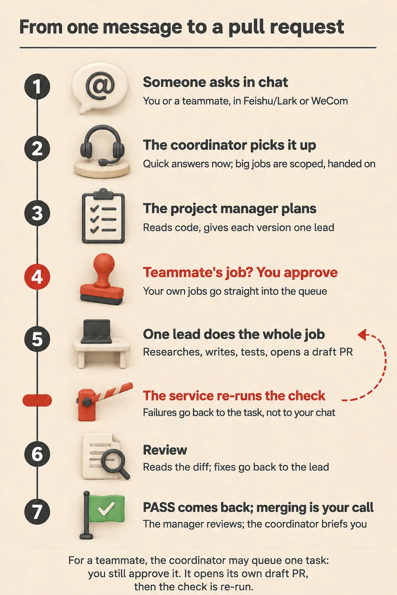
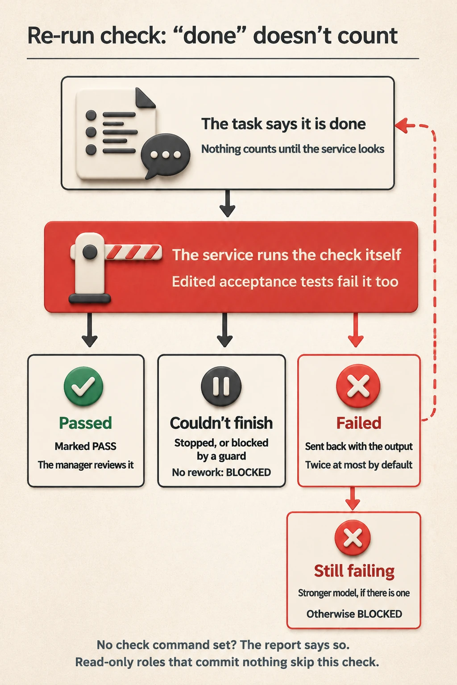
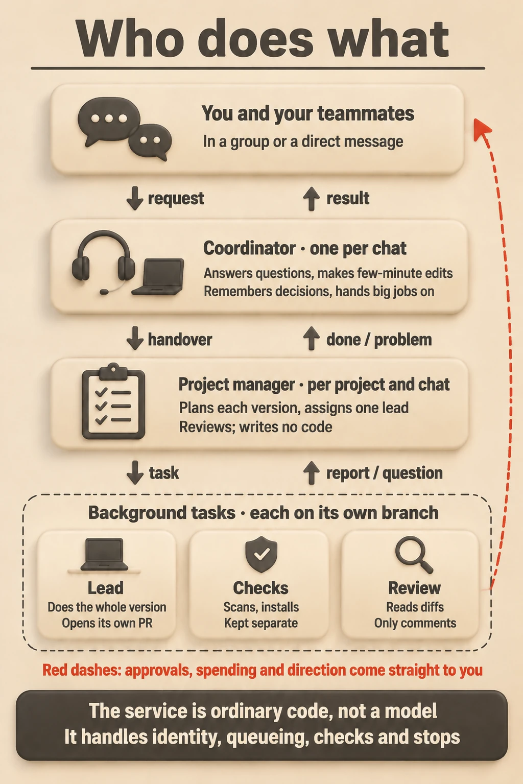
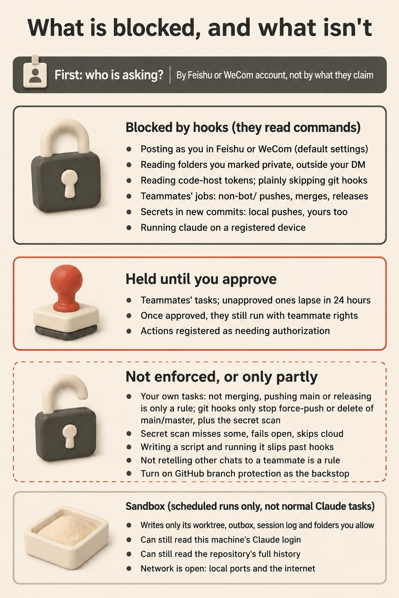

# Yonty Bot

> 3.19.10 · 2026-11-26 · MIT · [中文](README.md) | English

**Give Claude Code work from a Feishu/Lark or WeCom group chat.** A project manager gives each job to one lead agent, and the lead does the whole job on its own branch in the background. The service re-runs your verify command and reports PASS only if the command passes.

[](https://github.com/DwDestiny/yonty-bot/actions/workflows/ci.yml)
[](https://github.com/DwDestiny/yonty-bot/releases)
[](LICENSE)

<p align="center">

</p>

Self-hosted, MIT. You and your teammates share one group: a teammate's code question gets an answer on the spot, and a teammate's code change starts only after you approve. If a task has no verify command, the service does not re-check it, and the result says so.

Feishu is the Chinese workplace chat from ByteDance (its international version is Lark). WeCom is Tencent's enterprise WeChat. Yonty Bot connects to both. It has no link to either company.

<p align="center">
  <a href="#how-a-job-runs">How a job runs</a> ·
  <a href="#group-chat-examples">Group chat examples</a> ·
  <a href="#quick-start">Quick start</a> ·
  <a href="#how-it-works">How it works</a> ·
  <a href="#security-boundaries">Security boundaries</a> ·
  <a href="#docs">Docs</a>
</p>

## How a job runs

<p align="center">
  
</p>

This is a real screenshot (an excerpt) from the author's own instance. The interface is in Chinese. On the left is a direct message: a one-line request, and the bot starts. Later you say to merge when it is ready, and it merges into main and posts a link to the Feishu task. On the right is that Feishu task: done, with one line for each finished subtask. Names and avatars are replaced and the watermark is removed. Unrelated messages in between are left out, and the merge reply keeps only its first paragraph.

The steps from start to finish:

1. You say what you want built, in a direct message or a group, with a verify command.
2. The project manager reads the code, decides what this version covers and assigns one lead.
3. The lead works on its own branch in the background from start to finish: research, code, tests and a draft pull request.
4. When the lead says it is done, the service re-runs the verify command and sends the task back in the background if it fails. Then a reviewer reads the diff, and fixes go back to the same lead.
5. The re-run passes, so the result says PASS. The bot reports back in the chat where you gave the job, with a link to the draft pull request.

## Four highlights

**"Done" doesn't count.** For a task that has a verify command, the service runs that command again when the task says it is done. If it fails, the task goes back for rework, up to 2 times by default. If it still fails, the task comes back as BLOCKED. For a task without a verify command, the result says "no verify command set, not re-checked by the service".

**One job in, one draft pull request out.** The project manager writes the plan, assigns a lead and accepts the results. It does not write code itself. A project job gets one plan, one lead and one pull request per version. When the lead must read a lot, it starts subagents in its own session instead of splitting the job into many tasks. Only independent checks, blocks that need another machine or toolset, and the review run as separate tasks. The pull request is a draft, and you decide whether to merge. See [docs/tasks.md](docs/tasks.md).

**Use it together in a group.** A teammate @-mentions it with a code question. It looks and answers, with no approval from you. When a teammate wants a code change, it writes a task brief and waits for your approval before it starts. An approval that nobody gives expires after 24 hours by default. Who you are comes only from the sender ID that Feishu or WeCom provides. A message that claims "I'm the owner" counts for nothing.

**Progress shows up in Feishu Tasks.** With Feishu Tasks sync on, each job you give it in a direct message becomes a Feishu task: one per plan, with the bot as the assignee and you as a follower. Each finished subtask adds a line. The service, not the model, writes the time, models, cost and pull requests into the task description, and checks the task off when the work is done. Assigning a Feishu task to the bot also counts as giving it a job. Sync is off by default, and the app needs extra task permissions. See [docs/usage.md](docs/usage.md#10-飞书任务同步).

## Group chat examples

<table>
  <tr>
    <td width="50%" valign="top"></td>
    <td width="50%" valign="top"></td>
  </tr>
</table>

- **Banter (left).** Login keeps timing out, and Lao Chen and Xiao Lin blame each other. The bot checks the commits and finds who changed the timeout. Listen mode is on in this group, so the bot adds a joke without being @-mentioned. Xiao Lin asks it to change the timeout back. It writes a task brief and @-mentions you in the group, and the work starts only after you approve.
- **Work (right).** You give a job in the group. The bot hands it to the project manager, which assigns one lead. While the lead works, a teammate asks the bot about an API, and it answers on the spot. When the lead is done, the service re-runs `npm test`, the review passes, and the bot reports under your message with the pull request link.

Both pictures are staged. The names, the group and the dialogue are made up. The interface is Feishu on the web, and everything is in Chinese, because the service's own messages are in Chinese. 周宇 (Zhou Yu, blue bubbles) is you, and 小助理 (the dark "Y" avatar) is the bot. In the bot's messages, the task brief that waits for your approval, "批了，……排上了" (approved, queued), the "【shop】" prefix and the "派了 ……" (assigned …) line are the service's fixed wording, copied from the code. The other bot lines are made-up examples. In real use, the model writes them. For each line and where it comes from in the code, see [docs/assets/source/scenes/README.md](docs/assets/source/scenes/README.md).

## Where it fits

You can copy the lines below as they are. Replace `shop` with your repo name.

**You manage several repos alone.** Give work in a private chat.

> Add a failed-attempt limit to the login API in shop: lock for 10 minutes after 5 failures. Add tests and verify with `npm test`.

**Your team group has code questions.** A teammate just @-mentions it.

> @assistant Which file holds the order API in shop? What error code does it return when stock is too low?

**You want it in a Feishu group, but quiet.** This is called listen mode: it also reads messages that don't @-mention it, and stays silent by default. It exists only for Feishu groups. No group has it by default, and you turn it on group by group.

> @assistant /listen on

**You use both Feishu and WeCom.** You can connect both at once. They share one rules file, which holds the persona, tone and boundaries.

> List the tasks running in shop today and say which step each one is on.

### When not to use it

- You want a web admin console. There is none here. Everything happens in chat.
- You have no machine that can stay on.
- You mainly use agents other than Claude Code.
- You need Slack or Telegram. Only Feishu and WeCom are supported.
- Your group has people you don't trust, and you cannot narrow the app's availability scope. The bot has no allow-list of senders. Anyone who can reach it can make it read code and run commands on your machine.
- You want to run it on someone else's account.

## Quick start

You use your own Claude subscription. Before you install, read [When not to use it](#when-not-to-use-it), [Cost and subscription](#cost-and-subscription) and [Security boundaries](#security-boundaries).

Prepare an always-on machine (a Linux server is recommended), Claude Code and `lark-cli` installed and signed in, and a published Feishu custom app. The list below has the version requirements and the optional parts.

<details>
<summary><b>Prerequisites</b>: machine, command-line tools, Feishu app, Node.js versions, optional parts</summary>

- **An always-on machine:** A Linux server with systemd is recommended. To keep running after you log out, run `sudo loginctl enable-linger`. A Mac can work, but some features are missing, and it misses messages while the lid is closed.
- **Claude Code:** Install and sign in as described in the [official guide](https://code.claude.com/docs/en/setup). The bot uses its account and quota. npm package 2.1.332 needs Node 22 or later.
- **`lark-cli`:** The npm package [`@larksuite/cli`](https://www.npmjs.com/package/@larksuite/cli), needs Node 16 or later. Install it and sign in.
- **A Feishu custom app:** Turn on the bot capability, add permissions, subscribe to events and publish a version. A person has to do all four in the console. See [docs/setup.md](docs/setup.md). It uses a long connection, so no public callback URL is needed.
- **Node.js:** The three npm packages differ. `lark-cli` needs 16 or later, `wecom-cli` 18 or later, and the Claude Code npm package 22 or later. If you install all three, use 22 or newer.
- **Python 3.9 or later, git**
- **`gh` (optional):** Needed to open draft pull requests on GitHub.
- **bwrap (optional):** Needed for scheduled tasks with a limited read scope, and for ZCode tasks.
- **WeCom (optional):** `wecom-cli` 1.3.4 needs Node 18 or later. You scan a QR code to create a smart bot. One bot can have only one long connection. See [docs/wecom.md](docs/wecom.md).

</details>

> [!IMPORTANT]
> Before you add the bot to a group, narrow the app's availability scope in the Feishu console. The bot accepts every private message, and accepts a group message when someone @-mentions it.

When the prerequisites are ready:

1. Clone the repo and enter the folder.

   ```bash
   git clone https://github.com/DwDestiny/yonty-bot.git && cd yonty-bot
   ```

2. Open Claude Code in the repo and say "Follow docs/guide.md and set up a Feishu bot for me". It asks you a few things as the guide says, then generates the instance.
3. Install the service with the commands that the script prints. The script only generates files and prints commands. It does not start the service for you.
4. Follow the acceptance checklist in [docs/guide.md](docs/guide.md) and try each item in a real chat.

Cloning and generating an instance have been run in an isolated environment. Letting Claude Code do the install, and real Feishu and WeCom message flow, have not been re-tested from scratch.

The full manual install commands are in [docs/quickstart.md](docs/quickstart.md). Install `claude` and `lark-cli` before you generate the instance. If you change an install location, generate the instance again.

**Patch versions install automatically by default.** Yonty Bot, `lark-cli`, `wecom-cli` and `mcporter` update on their own for patch versions. For Claude Code updates and non-patch versions, it asks you first. Set `updates.enabled` to `false` to turn this off.

## How it works

<p align="center">

</p>

You are the person who installed the bot, called the "owner" in the docs. The roles split the work like this:

- **Coordinator:** the agent that talks with you and your teammates in chat. It answers questions and makes changes that take a few minutes. For a big job, it first asks for the goal, the scope and what counts as done, then hands the job and your original words to the project's project manager.
- **Project manager:** reads the code, writes the plan, sets the version, assigns one lead and accepts the result. It does not write code.
- **Lead:** works in the background in its own worktree on its own `bot/` branch, and takes one version from research to code to tests to a draft pull request.
- **Review:** started by the project manager when the lead is done. It only reads the diff. Fixes go back to the same lead.
- **Independent checks:** checks kept apart from the writer, such as a secret scan, or a clean install that follows the docs. Each pushes its own branch, and the lead merges them in.
- **The service:** ordinary code, not a model. It handles identity, queueing, the verify re-run and stops.

How jobs move and report back:

- **A job a teammate gives:** the coordinator writes the task brief, and work starts only after you approve.
- **Queueing:** tasks that touch the same files, or that wait on an earlier task, queue.
- **Reports:** when a task says it is done, the service re-runs the verify command. The first line of the report is the result: PASS, or where it got stuck. The coordinator tells you the result and anything you need to decide, in a few lines.
- **Pull requests:** each version gets one draft pull request, and you decide whether to merge.

> [!NOTE]
> A draft pull request does not mean the work was verified. Read the result. A default Claude task pushes its branch and opens the draft pull request first, and the service re-runs verification after that. Tasks that run in the Claude cloud and ZCode tasks work the other way around: the service opens the draft only after the re-run passes. Opening drafts works with GitHub and Alibaba Cloud Codeup. On other platforms you get the branch name.

<details>
<summary><b>Verify re-run outcomes</b>: passed, failed, still failing, couldn't finish</summary>

<p align="center">

</p>

</details>

<details>
<summary><b>Who does what</b>: coordinator, project manager, lead, and what the service handles</summary>

<p align="center">

</p>

</details>

## More features

- **Fixed leads and records.** A long-running area of work (for example login, or payment reconciliation) has a fixed lead. If it can continue the last session, it does. With a new session, it first reads the record: current status, open items and what was decided last time. See [docs/tasks.md](docs/tasks.md).
- **Acceptance tests written first.** Write `验收: 独立` (independent acceptance) when you give the task. Before work starts, another role reads the task brief and the existing code and writes tests. If a developer changes these new tests and the task has a verify command, the task is sent back, and you can lift that rule. If the tests could not be written, work starts as usual and the result says so. See [docs/tasks.md](docs/tasks.md).
- **Scheduled tasks.** Each scheduled task has its own permission scope, never wider than its creator's. By default it pauses after 3 failures in a row. A task with a limited read scope needs bwrap, and does not run without it. See [docs/schedules.md](docs/schedules.md).
- **Start only when memory allows.** The service looks at free memory and pressure to decide whether to start a new task. Send `/why shop#3` to see the reason (`shop#3` is a task ID). See [docs/tasks.md](docs/tasks.md).
- **Listen mode.** About every 40 seconds it pulls group messages with your Feishu identity, and handles them with the permissions of "not the owner". After it speaks, it cools down for 10 minutes. See [docs/boundary.md](docs/boundary.md).
- **Saving tokens.** A fixed prompt prefix, continuing sessions that have not expired, compacting before the cache expires, and cheaper models for cheap jobs. See [docs/cache.md](docs/cache.md).

## Cost and subscription

- Yonty Bot is free, under the MIT license.
- You need your own Claude subscription. No matter who @-mentions it, it uses the Claude account and quota that is signed in on this machine.
- Anthropic currently counts `claude -p` against your subscription quota. Its wording is "For now", so the rule may change. See the [official note](https://support.claude.com/en/articles/15036540-use-the-claude-agent-sdk-with-your-claude-plan) (checked 2026-11-25).
- A background task stops at its estimated cost and hands back, and the coordinator can decide whether to continue. Chat has no such cap.
- If subscription quota is being used fast, or a plan has gone over its estimate, it sends you a private message. It only warns. It does not stop work.
- When any quota window reaches 95%, or a limit is hit, the service pauses Claude tasks automatically, tells you in a private chat, and resumes when the quota refreshes. Tasks running in the Claude cloud cannot be paused. `tasks.quota_pause` sets this line, and 0 turns it off.
- The optional decision API is off by default, and its default backend is an external paid API. ZCode tasks use your own configuration.

## Security boundaries

<p align="center">

</p>

### Who can make it do what

- Identity comes only from the sender ID that Feishu or WeCom provides. The bot has no allow-list of senders. Who can reach it depends on the app's availability scope and on whether it was added to a group.
- Teammates can ask without your approval. A session that a teammate triggers can read code and run commands on this machine, limited by the permission mode (`auto` by default) and by hooks.
- Sessions and tasks that teammates trigger can push only `bot/` branches, and `gh` can only open drafts, view, file issues and comment. For sessions you trigger, `git` commands cannot force-push or delete main/master, and a normal push is allowed on any branch. "Do not merge, do not push to the main branch" is only a prompt rule for your tasks, so **turn on branch protection for the main branch**.
- Before a local session pushes, a hook checks the new commits for secrets and blocks the push on a match. It checks your sessions too. It recognizes only fixed token formats, private keys, key files and hard-coded long secrets, so it misses some. If the scan itself fails, the push goes through. Tasks that run in the Claude cloud do not pass this hook.
- Hooks block these by default: sending, editing or recalling Feishu messages as you, and sending WeCom messages and email as you. Setting `identity.owner` to `user` lifts the Feishu one.
- Reading private paths outside your private chat is blocked by hooks and a deny list. You configure what counts as private.

> [!WARNING]
> If you do not want sessions that teammates trigger to read Feishu chat history with your identity, change `identity.others` to `bot`. With the default setting they can, and only the rules file keeps them from passing it on.

### What is blocked and what is not

- Hooks block by command text. They stop the direct way, but not workarounds such as writing a script and running it, or `python -c`.
- Default chats and ordinary tasks run outside a sandbox, as the same system user as you. Scheduled tasks with a permission scope, and ZCode tasks, run in a sandbox. The sandbox does not isolate the network.
- A Claude session that can run commands can read the login credentials on this machine, and that includes the sandbox of a scheduled task. Use a machine you trust.

### Where content goes

- Session content, code it has read, earlier messages and listen-mode messages are sent by `claude` to Anthropic. A Feishu group gets up to 20 messages from the last 2 hours by default, and a private chat gets 24 hours. WeCom has no earlier messages.
- It checks for updates once a day, which reaches the official npm registry, GitHub and the source repository.
- The optional decision API (called `decide` in the config) is off by default. As soon as `decide.enabled` is changed to `true`, the template has `points.ambient` set to `shadow`, and **listen-mode decisions start going out**. `shadow` means the result is only recorded and has no effect, but the content is still sent.

<details>
<summary><b>What the decision API sends, where it goes, and how to turn it off</b></summary>

- **`points.ambient` (listen mode):** The names of the bot and the owner. For each message: the time (hour and minute), sender name, user ID and text, at most 400 characters per message. The first 3,000 characters of the listen section in the rules file. At most 20,000 characters per batch.
- **`points.task` (task dispatch; not in the template, add it yourself):** The task title and the full task brief, at most 20,000 characters. Sent only by the `jev` backend, and only for development jobs where the service picks the model. For a task a teammate gave, it is sent before you approve.

- Secrets in message text and task briefs are replaced by pattern. Phone numbers, email addresses and IPs are sent as they are.
- The `jev` backend sends to an external API, and this is the default. `openai` sends to the address you set. With `haiku`, listen-mode content is sent to Anthropic by the local `claude`. `rules` decides locally only.
- To turn it off: set `decide.enabled` to `false`, or set the matching `points.*` to `off`, then restart the service.

</details>

### Sign-in and terms

Yonty Bot is an independent project and has no link to Anthropic. It is a connector that drives the official command-line tool on your machine. For the Claude part, it runs the `claude` command that you installed and signed in to on this machine. The Yonty Bot service does not extract or forward Claude login tokens.

You read and follow the terms of the services you use, for example [Claude Code legal and compliance](https://code.claude.com/docs/en/legal-and-compliance) and the [Anthropic consumer terms](https://www.anthropic.com/legal/consumer-terms).

Details are in [docs/boundary.md](docs/boundary.md). Config, chat state and task data live in the instance folder, not in this repo.

## Current limits

- Claude Code is the main supported agent. Background development tasks also have a ZCode pilot that is off by default, and you have to supply the launcher. Codex is not implemented yet.
- A task with no verify command is not re-checked by the service. A read-only role that made no commit also gets no verification run.
- Data from real projects on fixed-lead records and on writing acceptance tests first is still being collected.
- The Mac is not tested in practice. The alert when the service dies and the `/upgrade` command rely on systemd, which a Mac does not have.
- There is no web console.
- The service's own messages are in Chinese only, for example approval requests, queue confirmations and the first line of task reports.
- The docs are mostly in Chinese.

## How it compares

This covers only projects whose README was read on 2026-11-25. A feature missing from a README does not mean the project lacks it.

- For several kinds of agents, several chat platforms or a web console, see [cc-connect](https://github.com/chenhg5/cc-connect). For a desktop workbench, see [emdash](https://github.com/generalaction/emdash).
- For a Feishu bridge with one command and a QR scan, with lists of users, groups and admins, see [lark-coding-agent-bridge](https://github.com/zarazhangrui/lark-coding-agent-bridge). For per-call approval of tool use and an audit log, see [wardendeck](https://github.com/bocoboho/wardendeck).
- For multi-agent division of work or review by another vendor's model, see [orcha](https://github.com/Ink-dark/orcha) and [cc-lark](https://github.com/yixin-1024/feishu-claude-code).
- Yonty Bot covers the path from a chat request to verification: a project manager gives each version to one lead, work runs on isolated branches in the background, the service re-runs the command that was set when the job was given, and a draft pull request comes back.

## Docs

Most docs are in Chinese.

- Set it up step by step, run the acceptance checklist, operate it: [docs/guide.md](docs/guide.md)
- Install by hand, from zero to the first reply: [docs/quickstart.md](docs/quickstart.md)
- Set up the Feishu console: [docs/setup.md](docs/setup.md)
- Connect WeCom: [docs/wecom.md](docs/wecom.md)
- Learn how to ask, assign, approve and check progress, with a command table: [docs/usage.md](docs/usage.md)
- Understand background tasks, IDs, approval and the verify re-run: [docs/tasks.md](docs/tasks.md)
- Create scheduled tasks and set permission scopes: [docs/schedules.md](docs/schedules.md)
- Check identity, private content and permission boundaries: [docs/boundary.md](docs/boundary.md)
- Look up every setting: [docs/config.md](docs/config.md)
- Read the architecture and roadmap: [docs/architecture.md](docs/architecture.md)
- See how caching saves tokens and how to check it: [docs/cache.md](docs/cache.md)
- Look up a problem by symptom: [docs/troubleshooting.md](docs/troubleshooting.md)
- Browse the index of all docs: [docs/README.md](docs/README.md)

For contributing, see [CONTRIBUTING.md](CONTRIBUTING.md). For security problems, see [SECURITY.md](SECURITY.md). For changes between versions, see [CHANGELOG.md](CHANGELOG.md). License: [MIT](LICENSE). The hero image and diagrams in this README are AI-generated and are not covered by the MIT license; see [docs/assets/README.md](docs/assets/README.md#来源与许可).
