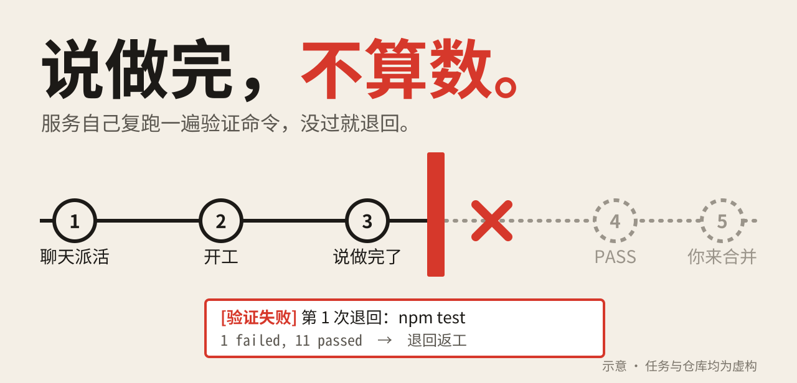
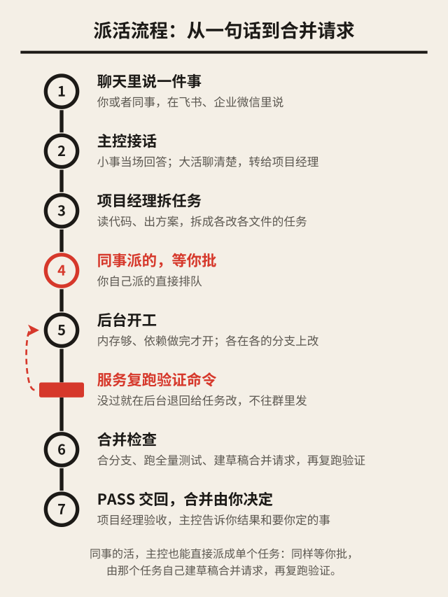
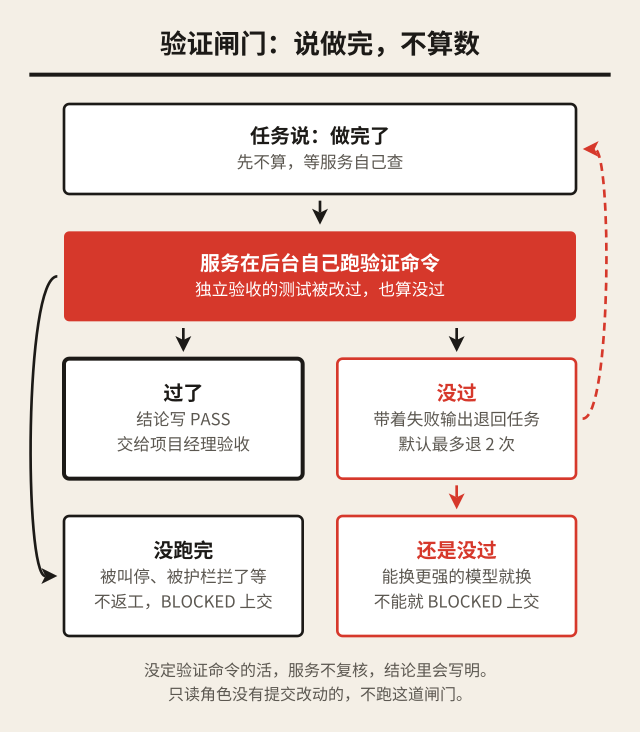
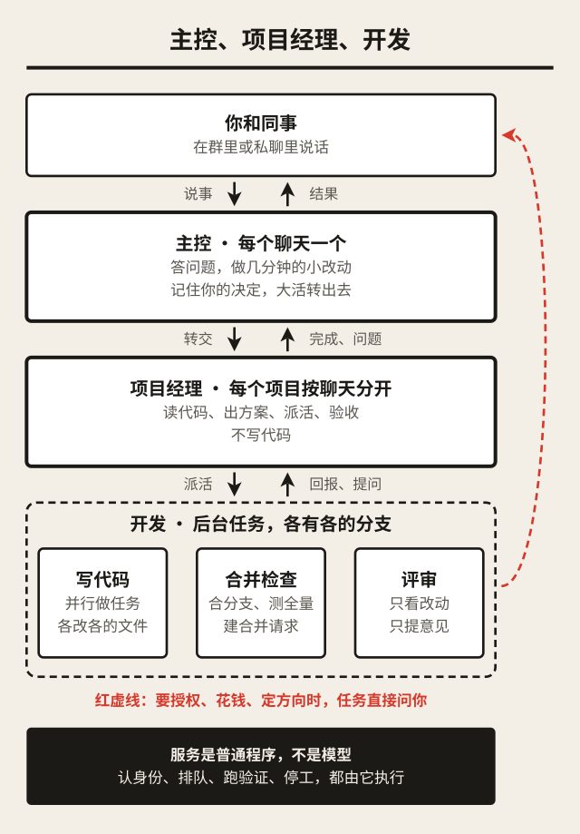
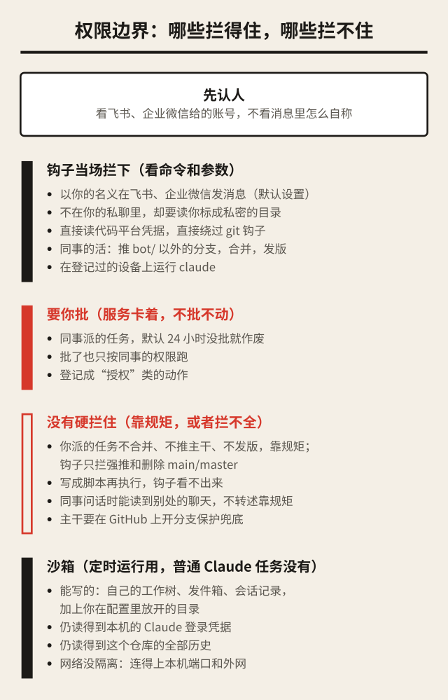

# Yonty Bot

> 3.19.4 · 2026-11-26 · MIT · 中文 | [English](README.en.md)

**在飞书、企业微信群里给 Claude Code 派活：一件事交给一个负责人，在后台的独立分支上做完，服务复跑验证命令，过了才报 PASS。**

自己部署，MIT。你和同事在同一个群里用：同事问代码当场答，同事要改代码，你批了才开工。没写验证命令的任务，服务不复核，结论里会写明。

<p align="center">
<picture>
  <source media="(prefers-color-scheme: dark)" srcset="docs/assets/hero/hero.zh.dark.svg">
  
</picture>
</p>

**前置备好后**（Linux 服务器、登录好的 Claude Code 和 `lark-cli`、已发布的飞书应用，清单见[安装](#安装)）：

1. 克隆仓库：`git clone https://github.com/DwDestiny/yonty-bot.git && cd yonty-bot`
2. 在仓库里打开 Claude Code，说：“照 docs/guide.md 帮我搭一个飞书机器人。”
3. 照 [docs/guide.md](docs/guide.md) 的验收清单，在聊天里逐条试。

要用你自己的 Claude 订阅。装之前先看[什么时候别用](#什么时候别用)、[费用和订阅](#费用和订阅)、[安全边界](#安全边界)。

## 一件活怎么走完

一件活从头到尾的样子。人名是虚构的，步骤按真实流程。

1. 你在群里说要做什么。
2. 项目经理读代码，定下这个版本做什么，派一个负责人。
3. 负责人在后台的独立分支上从头做到尾：调研、改代码、跑测试，建草稿合并请求。
4. 它说做完后，服务复跑验证命令，没过就在后台退回。过了再派一个评审只读看改动，要改的退回同一个负责人。
5. 复跑通过，结论写 PASS。机器人回到群里汇报，附上草稿合并请求的链接。

## 三个特点

**说做完，不算数。** 派活时写了验证命令的任务，说做完后由服务再跑一遍这条命令。没过就退回返工，默认最多退回 2 次，再不过就写 BLOCKED 交回。没写验证命令的任务，结论写“没定验证命令，服务没复核”。

**派一件事，收一个草稿合并请求。** 项目经理出方案、派负责人、验收，自己不写代码。项目类的活一个版本一个方案、一个负责人、一个合并请求；要读很多资料时，负责人在自己的会话里开子代理，不拆成一堆任务。只有独立检查、换机器换工具的块和评审才另开。建的是草稿，合不合由你决定，见 [docs/tasks.md](docs/tasks.md)。

**群里一起用。** 同事 @ 它问代码，不用你批，它直接查了回答。同事要改代码，它写好任务书，等你批了才开工，默认 24 小时没批就作废。谁是你，只看飞书、企业微信给的发送人 ID，消息里自称不算。

## 适合的场景

下面的原话可以直接复制，`shop` 换成你的仓库名。

**一个人管几个仓库。** 私聊派活。

> 给 shop 的登录接口加失败次数限制，5 次后锁 10 分钟。补测试，用 `npm test` 验证。

**团队群里问代码。** 同事 @ 它就行。

> @小助理 shop 的下单接口在哪个文件？库存不足时返回什么错误码？

**想让它在飞书群里看着，但别吵。** 这个功能叫旁听：没 @ 它的消息它也看，默认不出声。只有飞书群有，默认没有群打开，由你逐群打开。

> @小助理 /listen on

**飞书和企业微信都用。** 两边可以同时接，共用一份规则文件，里面写人设、语气和边界。

> 把今天 shop 在做的任务列一下，说说各自到哪一步了。

## 什么时候别用

- 你要网页管理后台。这里没有，操作都在聊天里。
- 你没有一台能常开的机器。
- 你主要用 Claude Code 以外的智能体。
- 你要接 Slack、Telegram。这里只有飞书和企业微信。
- 群里有你不信任的人，又没法收窄应用的可用范围。机器人没有发送人名单，能找到它的人就能让它在你的机器上读代码、跑命令。
- 你想用别人的账号跑。

## 它怎么干活

<p align="center">
<picture>
  <source media="(prefers-color-scheme: dark)" srcset="docs/assets/diagrams/flow.zh.dark.svg">
  
</picture>
</p>

**你派的活**（你是装机器人的人，文档里叫“主人”）：

1. 你在聊天里说一件事。主控是聊天里跟你说话的那个。小事它当场做，大活它先问清目标、范围和怎么算做完。
2. 主控把大活转给这个项目的项目经理，带上你的原话。项目经理读代码、出方案，派一个负责人。
3. 负责人在后台干活，有自己的工作树和 `bot/` 分支，从调研、改代码、跑测试一直做到建草稿合并请求。另开的独立检查（比如密钥扫描、干净环境照文档装一遍）各推各的分支，由负责人合进来。文件撞了或者前一个没做完的，排队。
4. 负责人做完，项目经理派评审只读看改动；要改的退回同一个负责人接着改。一个版本只建一个草稿合并请求。
5. 任务说做完后，服务复跑验证命令。回报的第一行是结论：PASS，或者卡在哪。
6. 主控用几句话告诉你结果和要你拍板的事。

**同事派的活**：主控写任务书，你批了才开工。

**草稿合并请求和验证的先后**：默认的 Claude 任务先推分支、建草稿合并请求，然后服务才复跑验证。所以看到草稿，不代表验证过了，要看结论。在 Claude 云端跑的任务和 ZCode 任务反过来，复跑过了才由服务建。建草稿支持 GitHub 和阿里云 Codeup，别的平台给你分支名。

<p align="center">
<picture>
  <source media="(prefers-color-scheme: dark)" srcset="docs/assets/diagrams/gate.zh.dark.svg">
  
</picture>
</p>

### 主控、项目经理、负责人各做什么

| 谁 | 做什么 |
|---|---|
| 主控 | 跟你和同事说话，答问题，做几分钟的小改动，把大活转出去 |
| 项目经理 | 定版本、出方案、派负责人、验收。不写代码 |
| 负责人 | 在后台的独立分支上把一个版本从头做到尾：调研、写代码、跑测试、建草稿合并请求 |
| 独立检查、评审 | 跟写的人分开看：密钥扫描、干净环境安装这类检查；评审只读看改动、提意见 |

<p align="center">
<picture>
  <source media="(prefers-color-scheme: dark)" srcset="docs/assets/diagrams/layers.zh.dark.svg">
  
</picture>
</p>

## 更多能力

- **固定负责人和记录**：一块长期的工作（例如登录、支付对账）有固定负责人。它能接着上次的会话就接着干，换了新会话就先读记录：现状、待办、上次定了什么。见 [docs/tasks.md](docs/tasks.md)。
- **先写好验收测试**：派活时写 `验收: 独立`，开工前由另一个角色看任务书和现有代码写测试。开发改了这些新测试，有验证命令时会被退回，你可以放开。测试没写成时照常开工，结论会写明。见 [docs/tasks.md](docs/tasks.md)。
- **定时任务**：每个定时任务有自己的权限范围，不超过创建它的人。默认连续失败 3 次就暂停。限定了读取范围的要装 bwrap，没装就不跑。见 [docs/schedules.md](docs/schedules.md)。
- **内存够才开工**：服务看内存余量和压力决定开不开新任务，发 `/why shop#3` 看理由（`shop#3` 是任务编号）。见 [docs/tasks.md](docs/tasks.md)。
- **旁听**：约 40 秒用你的飞书身份拉一次群消息，按“不是主人”的权限处理。插话之后冷却 10 分钟。见 [docs/boundary.md](docs/boundary.md)。
- **省 token**：固定提示前缀、接着没过期的会话用、缓存过期前先压缩、便宜的活用便宜的模型。见 [docs/cache.md](docs/cache.md)。
- **飞书任务同步**：默认关，要另开权限。见 [docs/config.md](docs/config.md)。

## 安装

先备好这些：

| 准备什么 | 说明 |
|---|---|
| 一台常开的机器 | 推荐有 systemd 的 Linux 服务器。退出登录后还要跑，需执行 `sudo loginctl enable-linger`。Mac 可以试，部分功能没有，合上盖子收不到消息 |
| Claude Code | 照[官方说明](https://code.claude.com/docs/en/setup)装好并登录。机器人用它的账号和额度。npm 包 2.1.332 要求 Node 22 以上 |
| `lark-cli` | npm 包 [`@larksuite/cli`](https://www.npmjs.com/package/@larksuite/cli)，要 Node 16 以上。装好并登录 |
| 飞书自建应用 | 开机器人能力、加权限、订阅事件、发布版本，四项都要人在后台做，见 [docs/setup.md](docs/setup.md)。用长连接，不需要公网回调地址 |
| Node.js | 三个 npm 包要求不同：`lark-cli` 16 以上，`wecom-cli` 18 以上，Claude Code 的 npm 包 22 以上。都装就直接用 22 或更新的 |
| Python 3.9 以上、git | |
| `gh`（可选） | 在 GitHub 上建草稿合并请求要用 |
| bwrap（可选） | 限定了读取范围的定时任务、ZCode 任务要用 |
| 企业微信（可选） | `wecom-cli` 1.3.4 要 Node 18 以上。扫码建智能机器人，同一个机器人只能有一条长连接，见 [docs/wecom.md](docs/wecom.md) |

> **注意**：拉群之前，先在飞书后台收窄应用的可用范围。机器人私聊全收，群里 @ 它就收。

前置备好后：

1. 克隆仓库，进入目录。

   ```bash
   git clone https://github.com/DwDestiny/yonty-bot.git && cd yonty-bot
   ```

2. 在仓库里打开 Claude Code，说“照 docs/guide.md 帮我搭一个飞书机器人”。它会照指南问你几件事，然后生成实例。
3. 脚本只生成文件、打印命令，不替你启动服务。照打印的命令装好服务。
4. 照 [docs/guide.md](docs/guide.md) 的验收清单，在聊天里逐条试。

克隆和生成实例在隔离环境里跑过。让 Claude Code 代装、真实飞书和企业微信的收发，还没有从头复测。

手动安装的完整命令见 [docs/quickstart.md](docs/quickstart.md)。先装好 `claude` 和 `lark-cli` 再生成实例，换了安装位置要重新生成。

**补丁版默认自动装**：Yonty Bot、`lark-cli`、`wecom-cli`、`mcporter` 出补丁版会自动更新。Claude Code 的更新和非补丁版先问你。`updates.enabled` 设成 `false` 就关掉。

## 费用和订阅

- Yonty Bot 免费，MIT 许可。
- 要你自己的 Claude 订阅。不管谁 @ 它，都用这台机器上登录的 Claude 账号和额度。
- Anthropic 目前把 `claude -p` 计入订阅额度，官方用词是“For now”，规则可能变。见[官方说明](https://support.claude.com/en/articles/15036540-use-the-claude-agent-sdk-with-your-claude-plan)（2026-11-25 查看）。
- 后台任务到预估花费就停下交回，主控可以决定续不续。聊天没有这个上限。
- 订阅额度用得快、方案花超了，它会私聊提醒你，只提醒，不停活。
- 任一额度窗口用到 95%，或者撞了限额，服务自动暂停 Claude 任务，私聊告诉你，额度刷新后接着干。在 Claude 云端跑的任务停不了。`tasks.quota_pause` 改这条线，设成 0 关掉。
- 可选的判断接口默认关，默认后端是外部付费接口。ZCode 任务用你自己的配置。

## 安全边界

<p align="center">
<picture>
  <source media="(prefers-color-scheme: dark)" srcset="docs/assets/diagrams/boundary.zh.dark.svg">
  
</picture>
</p>

### 谁能让它干什么

- 身份只看飞书、企业微信给的发送人 ID。机器人没有发送人名单，谁能找到它，由应用可用范围和拉没拉进群决定。
- 同事不用你批就能问。同事触发的会话能在这台机器上读代码、跑命令，受权限模式（默认 `auto`）和钩子限制。
- 同事触发的会话和任务只能推 `bot/` 分支，`gh` 只能建草稿、查看、提 issue 和评论。你触发的，`git` 命令不能强推或删除 main/master，普通推送不限分支。“不合并、不推主干”对你的任务只是提示词规矩，**主干请再开分支保护**。
- 本机会话推送前，钩子查新增提交里有没有密钥，命中就拦，你触发的也查。它只认固定格式的令牌、私钥、密钥文件和写死的长密钥，会漏报，扫描出错时放行。在 Claude 云端跑的任务不过这个钩子。
- 默认由钩子拦住：以你的名义发、改、撤飞书消息，以你的名义发企业微信消息和邮件。`identity.owner` 设成 `user` 会放开飞书这条。
- 在你的私聊以外读私密路径，由钩子和拒绝表拦。哪些算私密由你配置。

> **警告**：同事触发时，默认能用你的身份读飞书聊天记录，不转述只靠规则文件。不接受的话，把 `identity.others` 改成 `bot`。

### 拦得住和拦不住

- 钩子按命令文字拦，挡得住直接做法，挡不住写脚本再执行、`python -c` 这类绕法。
- 默认的聊天和普通任务不在沙箱里，跟你用同一个系统用户。带权限范围的定时任务和 ZCode 任务进沙箱。沙箱不隔离网络。
- 能跑命令的 Claude 会话读得到这台机器上的登录凭据，定时任务的沙箱里也一样。请用可信的机器。

### 内容发到哪里

- 会话内容、读到的代码、前文和旁听消息，由 `claude` 发给 Anthropic。飞书群默认带最近 2 小时最多 20 条前文，私聊带 24 小时。企业微信没有前文。
- 每天查一次更新，访问官方 npm 源、GitHub 和源码仓库。
- 可选的判断接口（配置里叫 `decide`）默认关。`decide.enabled` 一改成 `true`，模板里的 `points.ambient` 是 `shadow`，**旁听判断就开始外发**。`shadow` 的意思是结果只记录、不生效，内容照样发出去。

判断接口打开后发什么：

| 配置 | 发什么 |
|---|---|
| `points.ambient`（旁听） | 机器人和主人的名字。每条消息的时分、发送人名字、用户 ID 和文字，单条最多 400 字。规则文件里旁听那一节的前 3000 字。整批最多 2 万字 |
| `points.task`（派活，模板里没有，要自己加） | 任务标题和完整任务书，最多 2 万字。只有 `jev` 后端会发，只对服务自动定模型的开发活。同事派的，你批准之前就会发 |

- 消息文字和任务书里的密钥按格式替换。手机号、邮箱、IP 原样发。
- 后端选 `jev` 发给外部接口，这是默认值。选 `openai` 发给你填的地址，选 `haiku` 时旁听内容由本机 `claude` 发给 Anthropic，选 `rules` 只在本地判断。
- 要关：把 `decide.enabled` 设成 `false`，或者把对应的 `points.*` 改成 `off`，然后重启服务。

### 登录和条款

Yonty Bot 是独立项目，与 Anthropic 无关。它是驱动本机官方命令行的连接工具。Claude 部分运行你在这台机器上装好、登录好的 `claude` 命令，Yonty Bot 的服务不抽取、不转发 Claude 登录令牌。

使用者自行阅读并遵守所用服务的条款，例如 [Claude Code 法律与合规](https://code.claude.com/docs/en/legal-and-compliance) 和 [Anthropic 消费者条款](https://www.anthropic.com/legal/consumer-terms)。

细节见 [docs/boundary.md](docs/boundary.md)。配置、聊天状态和任务数据在实例目录里，不进本仓库。

## 现在的限制

- 主要支持 Claude Code。后台开发任务另有一个默认关闭的 ZCode 试点，启动器要自己提供。Codex 还没有实现。
- 没写验证命令的任务，服务不复核。只读角色没有提交时也不跑验证。
- 固定负责人的记录、先写验收测试，在真实项目上的数据还在积累。
- Mac 没有实测，服务挂掉后的报警和 `/upgrade` 升级命令靠 systemd，Mac 上没有。
- 没有网页后台。
- 文档以中文为主。

## 跟同类的关系

下面只说 2026-11-25 读过 README 的项目。README 没写，不等于没有。

- 要多种智能体、多个聊天平台或网页后台，看 [cc-connect](https://github.com/chenhg5/cc-connect)。要桌面工作台，看 [emdash](https://github.com/generalaction/emdash)。
- 要一条命令加扫码的飞书桥接，带用户、群和管理员名单，看 [lark-coding-agent-bridge](https://github.com/zarazhangrui/lark-coding-agent-bridge)。要逐次审批工具调用和审计记录，看 [wardendeck](https://github.com/bocoboho/wardendeck)。
- 要多智能体分工或换厂商的模型复核，看 [orcha](https://github.com/Ink-dark/orcha) 和 [cc-lark](https://github.com/yixin-1024/feishu-claude-code)。
- Yonty Bot 做的是从聊天派活到验证：项目经理把一个版本交给一个负责人，后台在独立分支上做，服务复跑派活时定的命令，交回草稿合并请求。

## 文档、贡献、许可

| 文档 | 讲什么 |
|---|---|
| `docs/README.md` | 全部文档的索引 |
| `docs/quickstart.md` | 手动安装，从零到第一条回复 |
| `docs/usage.md` | 怎么问、派活、批准、看进度，命令表 |
| `docs/troubleshooting.md` | 按现象查问题 |
| [docs/guide.md](docs/guide.md) | 搭建步骤、验收清单、运维 |
| [docs/setup.md](docs/setup.md) | 飞书后台配置 |
| [docs/wecom.md](docs/wecom.md) | 企业微信接入 |
| [docs/tasks.md](docs/tasks.md) | 后台任务、编号、审批、复跑验证 |
| [docs/schedules.md](docs/schedules.md) | 定时任务和权限范围 |
| [docs/boundary.md](docs/boundary.md) | 身份、私密内容、权限边界 |
| [docs/config.md](docs/config.md) | 全部配置项 |
| [docs/architecture.md](docs/architecture.md) | 架构和路线 |
| [docs/cache.md](docs/cache.md) | 缓存怎么省 token、怎么验证 |

贡献见 `CONTRIBUTING.md`，安全问题见 `SECURITY.md`，版本变化见 `CHANGELOG.md`。

许可：[MIT](LICENSE)。
